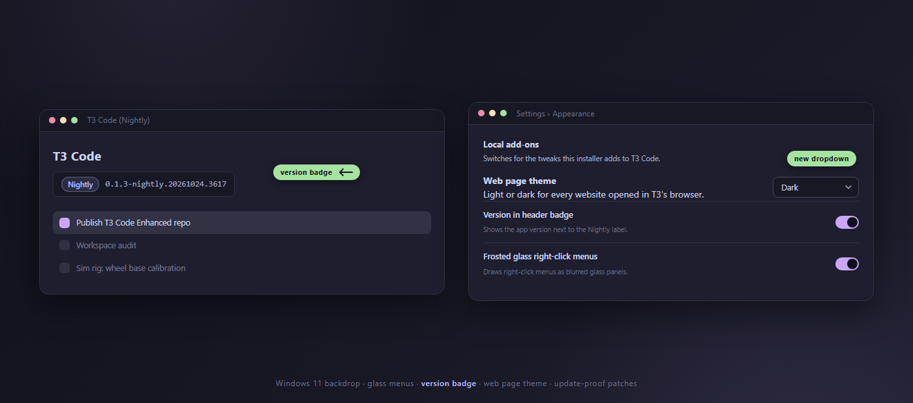

<div align="center">



# T3 Code Enhanced

**Patches for T3 Code on Windows that survive updates.**

Acrylic windows, frosted glass menus, a version badge in the header, and a dark default for the built-in browser, all switchable in the app's own settings.

<a href="https://github.com/DavidHiFi/t3-code-enhanced/releases/latest">

</a>

<br><br>


</div>

---

## Installation

1. Install [T3 Code](https://github.com/pingdotgg/t3code) (the per-user Windows install; Nightly and Beta both work).
2. Download `T3-Code-Enhanced-v1.0.1.zip` from the [latest release](https://github.com/DavidHiFi/t3-code-enhanced/releases/latest) and unzip it.
3. Double-click `install.cmd` (or run `install.ps1` in PowerShell 7). The installer finds your T3 Code folder, copies the add-ons, patches both asar files, and registers the `T3CodeEnhanced-Guard` scheduled task.
4. Restart T3 Code.

To remove everything: run `uninstall.cmd`. Your `~/.t3/local-patches.json` and your own `local-ui.css` stay.

## Features

### Look

- **Windows 11 backdrop:** acrylic, mica or tabbed material behind the whole window. `windhawk` hands the backdrop to a Translucent Windows rule instead.
- **Frosted glass menus:** right-click menus are drawn as blurred glass panels in the page instead of native Windows menus.
- **Extended glass:** the stock Glass opacity slider reaches the chat area and sidebar too, with a lighter mix for the composer.
- **Stronger highlights:** clearer selected rows in lists and menus, and visible edges on panels.
- **Galaxy accents:** star-field artwork in the sidebar header and the send button.

### Browser and window

- **Web page theme:** Dark, Light or System as the default for pages in T3's built-in browser. A tab that picks its own theme keeps it.
- **Version badge:** the app version after the channel label (Nightly, Beta) in the sidebar header. Switch it off in Settings > General or in the Local add-ons card.
- **Native title bar:** the Windows title bar instead of T3's drawn one. Off by default; applies after a restart.

### Behavior

- **No terminal for scripts:** running a project script never opens the bottom terminal, and closing the right panel never floats the preview.
- **Slower RPC budget:** slow backend calls get 60 seconds instead of 15, so long operations do not abort.
- **OpenCode budget (opt-in):** short budgets for OpenCode calls. Off by default in the config.
- **One button per script:** project scripts render as individual buttons with an arrow that runs all of them.

### Settings and upkeep

- **Local add-ons card:** every switch above lives in Settings > Appearance, and writes through to `~/.t3/local-patches.json`.
- **Guard task:** `T3CodeEnhanced-Guard` watches the install folder and re-applies every patch seconds after a T3 Code update. It never closes a window you are working in.
- **Same-length patches:** each edit keeps the patched file the same size, checks syntax after writing, and refuses to guess when a T3 build changes shape. The patch that changed is skipped and reported; the rest still apply.

## Notes

> [!NOTE]
> **Settings.** Everything lives in `~/.t3/local-patches.json`. Change it there or in Settings > Appearance > Local add-ons, then run `install.ps1` again (or restart T3 Code). Your own `~/.t3/local-ui.css` is never overwritten.

> [!IMPORTANT]
> **Tested builds.** Verified against `0.1.3-nightly.20261024.3617`. A newer build with changed internals is handled per patch: the changed one is skipped and reported, the rest still apply.

> [!WARNING]
> **This modifies installed files.** The patchers rewrite `app.asar` and `server.asar` inside T3 Code's install folder. Backups land in `%LOCALAPPDATA%\T3CodeEnhanced\backups`, and `uninstall.ps1` restores the stock files byte for byte. Antivirus software sometimes flags asar edits.

<details>
<summary><b>Building from source</b></summary>

<br>

Requirements: PowerShell 7 and Node.js (for the syntax checks). The `upstream/` submodule is pinned to the build these patches were checked against.

```
git clone --recurse-submodules https://github.com/DavidHiFi/t3-code-enhanced.git
```

Check an add-on after editing it:

```
node --check src/addons/local-main.cjs
```

Test the patchers against copies, never your live install:

```
pwsh -File src/lib/patch-server-asar.ps1 -Status -AsarPath C:\temp\server.asar -ConfigPath src/addons/local-patches.json -BackupDir C:\temp\backups
pwsh -File src/lib/patch-server-asar.ps1 -Apply  -AsarPath C:\temp\server.asar -ConfigPath src/addons/local-patches.json -BackupDir C:\temp\backups
pwsh -File src/lib/patch-server-asar.ps1 -Revert -AsarPath C:\temp\server.asar -ConfigPath src/addons/local-patches.json -BackupDir C:\temp\backups
```

</details>

## Contributing

Bug reports with your guard log (`%LOCALAPPDATA%\T3CodeEnhanced\guard.log`), your T3 Code version, and the patcher output help most.

<a href="CONTRIBUTING.md">

</a>

## Star history

Thank you for every star.

<a href="https://www.star-history.com/?repos=DavidHiFi%2Ft3-code-enhanced&amp;type=date">
  <picture>
    <source media="(prefers-color-scheme: dark)" srcset="https://api.star-history.com/chart?repos=DavidHiFi/t3-code-enhanced&amp;type=date&amp;theme=dark&amp;legend=top-left" />
    <source media="(prefers-color-scheme: light)" srcset="https://api.star-history.com/chart?repos=DavidHiFi/t3-code-enhanced&amp;type=date" />
    
  </picture>
</a>

## Credits

- **Author:** Myself, [DavidHiFi](https://github.com/DavidHiFi)

| Who | What |
|---|---|
| **[pingdotgg](https://github.com/pingdotgg)** ([T3 Code](https://github.com/pingdotgg/t3code)) | The app this patches. Pinned unmodified as the `upstream` submodule under its MIT license. |
| **[m417z](https://github.com/m417z)** ([Translucent Windows](https://windhawk.net/mods/translucent-windows)) | The optional `windhawk` material route paints the backdrop. |
| **[ramensoftware](https://github.com/ramensoftware)** ([Windhawk](https://windhawk.net/)) | The mod engine that route rides on. |
| **[Catppuccin](https://github.com/catppuccin/catppuccin)** | The Mocha palette the glass and highlight styles are mixed from. |

Built on [T3 Code](https://github.com/pingdotgg/t3code), with [PowerShell 7](https://github.com/PowerShell/PowerShell) and [Node.js](https://nodejs.org) for the patchers and checks.

> Missing or wrong credit? [Open an issue](https://github.com/DavidHiFi/t3-code-enhanced/issues/new) and I'll fix it.

## Disclaimers

Most of this project's code was developed with AI coding agents, including Claude and DeepSeek. No single AI agent made the project. Every patch was verified against a real T3 Code install before release.

The add-ons run locally and send nothing anywhere; the only network use is T3 Code itself. Patches are matched against the build they were written for and skip themselves when a T3 update changes the code shape.

<div align="center">
<br>
<sub>Not affiliated with pingdotgg. Requires T3 Code (Windows).</sub>
</div>
