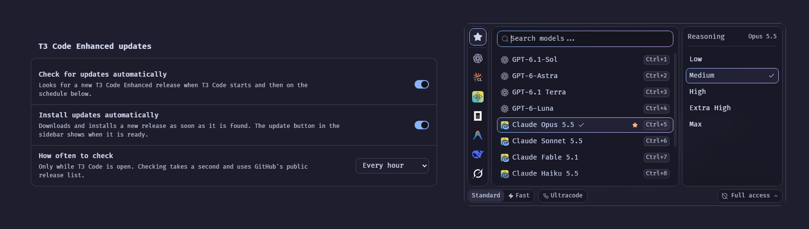

<div align="center">



# T3 Code Enhanced

**A Catppuccin Mocha theme and a set of patches for T3 Code on Windows, with its own updater.**

Install it once. It keeps itself up to date and puts its patches back after every T3 Code update.

<a href="https://github.com/DavidHiFi/t3-code-enhanced/releases/latest">

</a>

<br><br>


</div>

---

## Installation

1. Install [T3 Code](https://github.com/pingdotgg/t3code) for your Windows user. Nightly and Beta both work.
2. Download `T3-Code-Enhanced-v2.1.11.zip` from the [latest release](https://github.com/DavidHiFi/t3-code-enhanced/releases/latest) and unzip it anywhere.
3. Double-click `install.cmd`. If PowerShell 7 is missing, it offers to install it with winget first.
4. Restart T3 Code.

That's the last time you need the zip. New releases show up as a button in T3 Code and install themselves (see [Updates](#updates)). To remove everything, run `uninstall.cmd`; your `~/.t3/local-patches.json` and your own `local-ui.css` stay.

## Features

### Look

- **Catppuccin Mocha theme:** Mocha colours across the whole app, with blue and mauve accents. T3's System appearance opens dark even when Windows is in light mode; pick Light in T3's settings to keep it light.
- **Frosted surfaces:** the chat box, menus, tooltips and dialogs blur what's behind them, so text never shows through.
- **Mocha text selection:** selected text gets a soft Mocha blue highlight everywhere, reply cards included.
- **Hover frames:** rows, cards, buttons, menus and settings controls get a thin blue to mauve frame on hover and a grey edge at rest.
- **Model picker panels:** the provider rail, the model list and the Reasoning list each sit in their own panel.
- **Windows 11 backdrop:** acrylic, mica or tabbed material behind the window. `windhawk` hands the backdrop to a Translucent Windows rule instead.
- **Frosted right-click menus:** drawn in the page as glass panels instead of native Windows menus.
- **Galaxy accents:** star-field artwork in the sidebar header and on the send button.
- **App icon:** pick Riced (a Mocha T3 icon) or Original in Settings > Appearance. It changes the window, the taskbar, Start, desktop shortcuts and the sidebar corner. The program file itself switches the next time T3 Code closes.
- **Clean sidebar corner:** the top-left corner shows only the app icon, with a soft glow on hover that is never cut off.
- **Working colour:** pick the colour of the sidebar's Working spinner, label and timer. Defaults to Mocha blue `#89b4fa`.

### Updates

- **Enhanced update button:** a second button beside T3's own update button in the sidebar footer. Click it to check for a new release. When one is out it installs it, then asks you to reload or restart.
- **Settings card:** Settings > About has a "T3 Code Enhanced updates" card under T3's own update settings, with switches for checking and installing automatically, how often to check (every hour, every 6 hours or once a day), a Check now button and the last result.
- **Checked downloads:** each release zip is matched against its SHA-256 file before anything runs, then that release's installer runs hidden.

### Browser and window

- **Web page theme:** Dark, Light or System as the default for pages in T3's built-in browser.
- **Version badge:** the app version after the Nightly or Beta label in the sidebar header.
- **Native title bar:** the Windows title bar instead of T3's drawn one. Off by default.

### Behavior

- **No terminal for scripts:** running a project script never opens the bottom terminal, and closing the right panel never floats the preview.
- **Longer RPC budget:** slow backend calls get 60 seconds instead of 15, so long operations don't abort.
- **One button per script:** project scripts show as separate buttons, with an arrow that runs them all.
- **Seconds on sidebar timers:** `Working 23m 27s` in the sidebar, like the open thread shows. Helper agents in the Lineage list get seconds too.
- **Every account in the Limits popover:** usage for every account T3 can read for that provider, including each CLIProxyAPI account. Name rows with `"accountNames": { "you@example.com": "Max" }` in the config.
- **OpenCode budget (opt-in):** a longer start-up budget for OpenCode. Off by default. T3 now sets two of the three budgets itself, so the patch covers the one that is left.

### Upkeep

- **Local add-ons card:** the switches above live in Settings > Appearance and write to `~/.t3/local-patches.json`.
- **Guard task:** `T3CodeEnhanced-Guard` re-applies every patch seconds after a T3 Code update. It never closes a window you're working in.
- **Careful patches:** each edit keeps the patched file the same size and checks syntax after writing. If a T3 build changes shape, that one patch is skipped and reported; the rest still apply.

## Notes

> [!NOTE]
> **Speed.** Version 2.0 rewrote the theme rules that made T3 Code sluggish. Adding a chat message used to cost about 90 ms of style work with the theme on; it now costs under 2 ms.

> [!IMPORTANT]
> **Tested builds.** Checked against T3 Code `0.1.12-nightly.20261122.5071`, where every patch applies. On any build with changed internals, the affected patch is skipped and reported, and the rest still apply.

> [!WARNING]
> **This modifies installed files.** The patchers rewrite `app.asar` and `server.asar` in T3 Code's install folder, and the Riced app icon is written into `T3 Code.exe` after T3 closes. The originals are backed up to `%LOCALAPPDATA%\T3CodeEnhanced\backups`, and `uninstall.cmd` puts them back byte for byte, original icon included. Some antivirus software flags asar edits.

<details>
<summary><b>Settings file and installer options</b></summary>

<br>

Everything lives in `~/.t3/local-patches.json`. The updater reads its part from `enhancedUpdates`:

```json
"enhancedUpdates": { "check": true, "install": true, "intervalHours": 6 }
```

`install.ps1` is safe to run again at any time. Options:

```
-Reset     put every add-on and setting back to the release defaults (backed up first)
-NoTask    skip the guard task (patches then stop after the next T3 Code update)
-Quiet     plain output, used by the updater
```

</details>

<details>
<summary><b>Building from source</b></summary>

<br>

Requirements: PowerShell 7 and Node.js (for the syntax checks). The `upstream/` submodule is pinned to the T3 Code source these patches were checked against.

```
git clone --recurse-submodules https://github.com/DavidHiFi/t3-code-enhanced.git
node --check src/addons/local-main.cjs
```

Test the patchers on a copy, never your live install:

```
pwsh -File src/lib/patch-server-asar.ps1 -Status -AsarPath C:\temp\server.asar -ConfigPath src/addons/local-patches.json -BackupDir C:\temp\backups
pwsh -File src/lib/patch-server-asar.ps1 -Apply  -AsarPath C:\temp\server.asar -ConfigPath src/addons/local-patches.json -BackupDir C:\temp\backups
pwsh -File src/lib/patch-server-asar.ps1 -Revert -AsarPath C:\temp\server.asar -ConfigPath src/addons/local-patches.json -BackupDir C:\temp\backups
```

</details>

## Contributing

Bug reports help most when they include your T3 Code version, the guard log (`%LOCALAPPDATA%\T3CodeEnhanced\guard.log`) and the installer output.

<a href="CONTRIBUTING.md">

</a>

## Star history

Thank you for every star.

<a href="https://www.star-history.com/?repos=DavidHiFi%2Ft3-code-enhanced&amp;type=date">
  <picture>
    <source media="(prefers-color-scheme: dark)" srcset="https://api.star-history.com/chart?repos=DavidHiFi/t3-code-enhanced&amp;type=date&amp;theme=dark&amp;legend=top-left" />
    <source media="(prefers-color-scheme: light)" srcset="https://api.star-history.com/chart?repos=DavidHiFi/t3-code-enhanced&amp;type=date" />
    
  </picture>
</a>

## Credits

- **Author:** Myself, [DavidHiFi](https://github.com/DavidHiFi)

<!-- contributors:start -->
- **AI coding agents:** [Claude Code](https://github.com/anthropics/claude-code) and Halo Sparks

<p>
  <a href="https://github.com/DavidHiFi"></a>
  <a href="https://github.com/anthropics/claude-code"></a>
</p>

<sub>GitHub's contributor list also shows openhands-agent. Our machines had the wrong git name set from late October to November 26, 2026, so some commits by the agents above carry that name. OpenHands did not work on this project.</sub>
<!-- contributors:end -->

| Who | What |
|---|---|
| **[pingdotgg](https://github.com/pingdotgg)** ([T3 Code](https://github.com/pingdotgg/t3code)) | The app this patches. Pinned unmodified as the `upstream` submodule under its MIT license. |
| **[Catppuccin](https://github.com/catppuccin/catppuccin)** | The Mocha palette the whole theme is built from. |
| **[m417z](https://github.com/m417z)** ([Translucent Windows](https://windhawk.net/mods/translucent-windows)) | Paints the backdrop on the optional `windhawk` material route. |
| **[ramensoftware](https://github.com/ramensoftware)** ([Windhawk](https://windhawk.net/)) | The mod engine that route runs on. |
| **[Electron](https://github.com/electron)** ([rcedit](https://github.com/electron/rcedit)) | Writes the chosen icon into the program file. Shipped unmodified as `bin/rcedit-x64.exe` under its MIT license. |

Built on [T3 Code](https://github.com/pingdotgg/t3code), with [PowerShell 7](https://github.com/PowerShell/PowerShell) and [Node.js](https://nodejs.org) for the installer, patchers and checks.

> Missing or wrong credit? [Open an issue](https://github.com/DavidHiFi/t3-code-enhanced/issues/new) and I'll fix it.

## Disclaimers

I build this with AI coding agents: Claude Code (Claude Opus, Sonnet and Haiku) and DeepSeek wrote most of the code. Every change was checked on a real T3 Code install before release.

The updater is the only part that goes online. It asks GitHub for the latest release of this repo when T3 Code starts and on the schedule you pick, and downloads the zip when you install one. Turn off "Check for updates automatically" in Settings > About to stop that. Nothing else is sent anywhere.

<div align="center">
<br>
<sub>Not affiliated with pingdotgg. Requires T3 Code (Windows).</sub>
</div>
